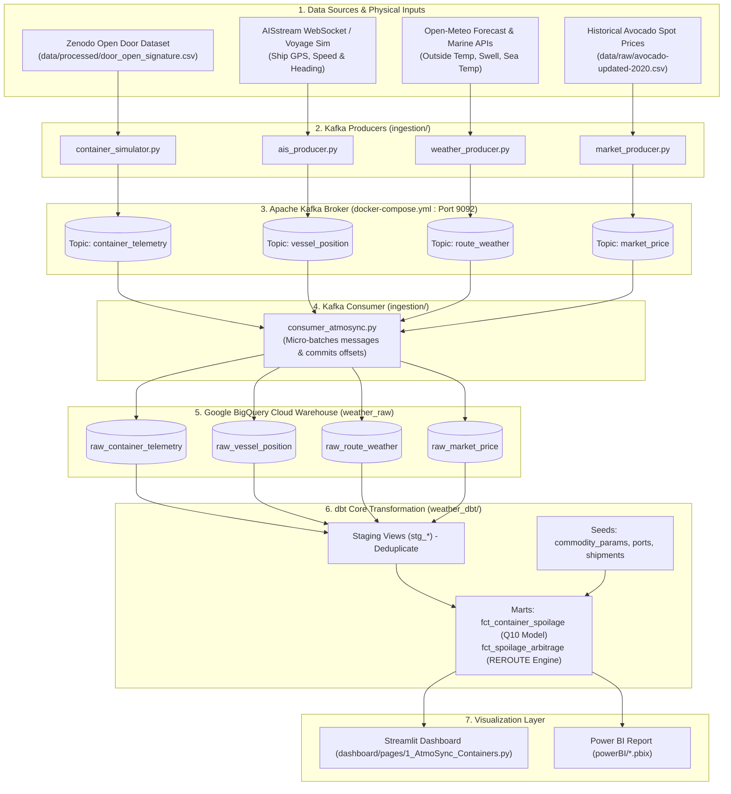

# AtmoSync: Micro-Climate & Spoilage Arbitrage Analytics
### Real-Time IoT Streaming Pipeline (Kafka + BigQuery + dbt Core + Streamlit / Power BI)

[](https://kafka.apache.org/)
[](https://cloud.google.com/bigquery)
[](https://www.getdbt.com/)
[](https://streamlit.io/)
[](https://powerbi.microsoft.com/)

---

## 📌 1. Project Purpose & Use Case

Traditional agricultural supply chain analytics rely on macro-weather forecasts and static transit schedules. They fail to track how **real-time, hyper-local micro-climate shifts** (such as internal refrigeration drift and container door openings) accelerate the biological spoilage of perishable commodities in transit.

**The Solution:** **AtmoSync** is an end-to-end data platform that streams internal container IoT telemetry, ship AIS coordinates, ambient ocean weather, and terminal spot market prices through **Apache Kafka** into **Google BigQuery**. It transforms raw event streams with **dbt Core** to calculate biological shelf-life degradation curves and dynamically evaluate **"Spoilage Arbitrage"**:
> *If an in-transit container experiences cooling failure, AtmoSync instantly alerts traders to reroute the container to a closer secondary market—securing a premium Grade A price before the commodity degrades below acceptable market thresholds.*

---

## 🏗️ 2. End-to-End System Architecture



---

## 📂 3. Project File Architecture (Annotated with Kafka Roles)

```text
AtmoSync-Micro-Climate-Arbitrage-Analytics/
│
├── 🐳 docker-compose.yml                      # 🌐 [KAFKA BROKER] Apache Kafka 3.7.0 in KRaft mode (Port 9092)
├── 📦 requirements.txt                        # Python dependencies (kafka-python-ng, google-cloud-bigquery, dbt, etc.)
├── 🔑 .env                                    # Environment config (Kafka bootstrap URL, GCP Project ID, AIS mode)
│
├── 📂 ingestion/                              # ⚡ [STREAMING LAYER - KAFKA ENGINE]
│   ├── config.py                             # ⚙️ Kafka bootstrap ('localhost:9092'), topic names, and seed loaders
│   ├── kafka_utils.py                        # 🔌 Shared Kafka Producer wrapper (send & flush with buffer management)
│   │
│   ├── ── [KAFKA PRODUCERS (Data Emitters)] ──
│   ├── container_simulator.py                # 🥑 Producer 1 ➔ Publishes to Kafka Topic: 'container_telemetry'
│   │                                         #    (Replays door-open events & simulates container cooling drifts)
│   ├── ais_producer.py                       # 🚢 Producer 2 ➔ Publishes to Kafka Topic: 'vessel_position'
│   │                                         #    (Streams real-time ship GPS coordinates & speed over ground)
│   ├── weather_producer.py                   # 🌊 Producer 3 ➔ Publishes to Kafka Topic: 'route_weather'
│   │                                         #    (Fetches ambient air temp, wave height, and sea surface temp)
│   ├── market_producer.py                    # 💰 Producer 4 ➔ Publishes to Kafka Topic: 'market_price'
│   │                                         #    (Streams live spot prices per destination port: Seattle, LA, SF)
│   │
│   ├── ── [KAFKA CONSUMER (Warehouse Loader)] ──
│   └── consumer_atmosync.py                  # 📥 Multi-Topic Consumer: Subscribes to ALL 4 Kafka topics simultaneously,
│                                             #    batches messages into micro-batches, executes BigQuery load jobs,
│                                             #    and commits Kafka offsets only after successful ingestion.
│
├── 📂 data/                                  # 📁 [PHYSICAL DATASETS]
│   ├── raw/open_door.csv                     # 🔬 Real laboratory IoT experiment from Zenodo (door openings)
│   ├── raw/avocado-updated-2020.csv          # 📈 Real historical commodity prices by US market region
│   └── processed/door_open_signature.csv     # 📐 Extracted temperature/humidity curve used by container_simulator
│
├── 📂 state/                                 # 💾 [RUNTIME PIPELINE STATE]
│   └── vessel_latest.json                    # 📍 Shared ship coordinates written by ais_producer for weather_producer
│
├── 📂 sql/                                   # 🗄️ [BIGQUERY DDL SCHEMAS]
│   ├── 01_bigquery_setup.sql                 # Initial weather schemas
│   └── 02_atmosync_tables.sql                # 4 Partitioned & Clustered raw tables matching the 4 Kafka topics:
│                                             #    - raw_container_telemetry
│                                             #    - raw_vessel_position
│                                             #    - raw_route_weather
│                                             #    - raw_market_price
│
├── 📂 weather_dbt/                           # 🔄 [DATA TRANSFORMATION LAYER - dbt Core]
│   ├── dbt_project.yml                       # dbt configuration & freight/arbitrage threshold parameters
│   ├── profiles.yml                          # BigQuery connection credentials
│   ├── 📂 seeds/                             # Business reference tables:
│   │   ├── commodity_params.csv              # Q10 degradation factor, target temp (6.0°C), shelf life (21 days)
│   │   ├── ports.csv                         # Manzanillo, Seattle, Los Angeles, and Oakland coordinates
│   │   └── shipments.csv                     # Container-to-vessel mapping & simulated cooling fault rates
│   └── 📂 models/
│       ├── sources.yml                       # Maps BigQuery raw tables loaded by Kafka consumer
│       ├── schema.yml                        # 14 Data Quality Tests (not_null, unique, accepted_values)
│       ├── staging/                          # Deduplication views on top of raw Kafka tables:
│       │   ├── stg_container_telemetry.sql   # Filters nulls & dedupes container readings by timestamp
│       │   ├── stg_vessel_position.sql       # Validates latitude/longitude & filters out bogus AIS speeds
│       │   ├── stg_route_weather.sql         # Dedupes ambient & marine readings
│       │   └── stg_market_price.sql          # Dedupes spot prices by port
│       └── marts/                            # Curated analytics tables:
│           ├── fct_container_spoilage.sql    # Calculates biological Q10 shelf-life consumption over time
│           ├── fct_container_latest.sql      # Real-time container health status ('OK', 'WARNING', 'CRITICAL')
│           ├── fct_vessel_latest.sql         # Latest vessel positions & 1-hour average speed
│           ├── fct_route_weather_latest.sql  # Latest weather & wave height at current ship position
│           ├── fct_market_latest.sql         # Latest spot price per market
│           └── fct_spoilage_arbitrage.sql    # 🎯 CORE ARBITRAGE MODEL: Computes ETA, arrival quality,
│                                             #    price degradation, freight deductions, and REROUTE advice.
│
├── 📂 dashboard/                             # 📊 [PRESENTATION LAYER - STREAMLIT]
│   ├── app.py                                # Main Streamlit entrance
│   └── 📂 pages/
│       └── 1_AtmoSync_Containers.py          # 🥑 AtmoSync Executive Dashboard: Live Reroute Alerts,
│                                             #    24h Drift Curves, Door-Open Markers, Map, & Arbitrage Matrix
│
├── 📂 powerBI/                               # 📈 [BI VISUALIZATION - POWER BI]
│   └── AtmoSync-Micro-Climate-Arbitrage-Analytics.pbix # Power BI report connected directly to BigQuery
│
└── 📂 scripts/                               # 🛠️ [PIPELINE UTILITIES]
    ├── prepare_door_signature.py             # Generates door_open_signature.csv from open_door.csv
    ├── prepare_avocado_prices.py             # Prepares historical market price time series
    ├── setup_atmosync_tables.py              # Automates creation of the 4 BigQuery tables
    └── seed_atmosync_data.py                 # Seeds initial telemetry directly for validation
```

---

## ⚡ 4. Kafka Topics & Messaging Specifications

| Topic Name | Producer Script | Target BigQuery Table | Key Fields in Payload |
|---|---|---|---|
| **`container_telemetry`** | `ingestion/container_simulator.py` | `raw_container_telemetry` | `container_id`, `internal_temp_c`, `internal_humidity_pct`, `door_open`, `observed_at` |
| **`vessel_position`** | `ingestion/ais_producer.py` | `raw_vessel_position` | `mmsi`, `ship_name`, `latitude`, `longitude`, `sog_knots`, `cog_deg` |
| **`route_weather`** | `ingestion/weather_producer.py` | `raw_route_weather` | `container_id`, `ambient_temp_c`, `wind_speed_kmh`, `wave_height_m`, `sea_surface_temp_c` |
| **`market_price`** | `ingestion/market_producer.py` | `raw_market_price` | `port_id`, `price_region`, `price_per_unit_usd`, `source` |

---

## 🧮 5. Biological Spoilage & Arbitrage Mathematics

### A. Q10 Biological Degradation Model
Shelf-life degradation increases exponentially when the container temperature rises above the commodity's reference carriage temperature:
$$r_{\text{temp}} = \max\left(1.0, Q_{10}^{\frac{T_{\text{internal}} - T_{\text{ref}}}{10}}\right)$$
* For avocados: $T_{\text{ref}} = 6.0^\circ\text{C}$, $Q_{10} = 2.5$.
* When humidity is outside the optimal band ($85\% - 95\%$), a **$1.25\times$** penalty multiplier applies:
$$r_{\text{total}} = r_{\text{temp}} \times r_{\text{humidity}}$$

### B. Quality on Arrival & Price Tiers
Given the ship's current speed and geodesic distance to destination market $M$:

\text{ETA}_{\text{hours}} =
\frac{\text{Distance}_{\text{km}}}{\text{Speed}_{\text{km/h}}}
\text{Quality}_{\text{arrival}} =
\max\left(
0,\;
\text{Quality}_{\text{current}}
-
\frac{\text{ETA}_{\text{hours}} \times r_{\text{total}}}
{\text{BaseShelfLife} \times 24}
\right)

* **Grade A ($\ge 0.80$):** $100\%$ market price multiplier.
* **Grade B ($\ge 0.60$):** $70\%$ market price multiplier.
* **Grade C ($\ge 0.40$):** $35\%$ market price multiplier.
* **Spoiled ($< 0.40$):** $0\%$ value.

### C. Spoilage Arbitrage
$$\text{Net Value} = (\text{Quantity}_{\text{kg}} \times \text{SpotPrice} \times \text{Multiplier}) - \text{FreightCost}$$
$$\text{Spoilage Arbitrage} = \text{Net Value}_{\text{Secondary}} - \text{Net Value}_{\text{Primary}}$$
* **Recommendation:** If $\text{Spoilage Arbitrage} > \$500$, trigger **`REROUTE`** alert.

---

## 🚀 6. Quickstart & Execution Guide

### 1. Start Apache Kafka
Make sure Docker Desktop is running, then execute:
```powershell
docker compose up -d
```

### 2. Run the Streaming Ingestion Pipeline
Open separate terminal tabs (with virtual environment active):
```powershell
# Tab 1: Multi-topic Consumer
.\venv\Scripts\python.exe ingestion/consumer_atmosync.py

# Tab 2: Vessel AIS Stream
.\venv\Scripts\python.exe ingestion/ais_producer.py

# Tab 3: Container Telemetry Simulator
.\venv\Scripts\python.exe ingestion/container_simulator.py

# Tab 4: Route Weather & Marine Swell
.\venv\Scripts\python.exe ingestion/weather_producer.py

# Tab 5: Spot Market Prices
.\venv\Scripts\python.exe ingestion/market_producer.py
```

### 3. Run dbt Transformation & Quality Tests
```powershell
# Load reference seeds (commodity_params, ports, shipments)
.\venv\Scripts\dbt.exe seed --project-dir weather_dbt --profiles-dir weather_dbt

# Build all views, tables, and arbitrage mart models
.\venv\Scripts\dbt.exe run --project-dir weather_dbt --profiles-dir weather_dbt

# Run all 14 data quality tests
.\venv\Scripts\dbt.exe test --project-dir weather_dbt --profiles-dir weather_dbt
```

### 4. Launch Dashboards

#### Plan A: Streamlit Web Dashboard
```powershell
.\venv\Scripts\streamlit.exe run dashboard/app.py
```
* Open `http://localhost:8501` and navigate to **`1_AtmoSync_Containers`** in the sidebar.

#### Plan B: Power BI Desktop
* Open [`powerBI/AtmoSync-Micro-Climate-Arbitrage-Analytics.pbix`](file:///c:/Users/ASUS/Desktop/AtmoSync%20Micro-Climate%20Arbitrage%20Analytics/powerBI/AtmoSync-Micro-Climate-Arbitrage-Analytics.pbix) in Power BI Desktop to interact with the pre-built visual report.

---

## 📜 Attribution & Data Licenses

* **Cold Chain IoT Measurements (Zenodo):** Gorka Manzanares López-Ocaña & Ascensión López Vargas, Universidad Politécnica de Madrid (DOI `10.5281/zenodo.20540723`), licensed under **CC BY 4.0**.
* **Weather & Sea Surface Telemetry:** [Open-Meteo.com](https://open-meteo.com/), licensed under **CC BY 4.0**.
* **Ship AIS Telemetry:** [AISstream.io](https://aisstream.io/).
* **Commodity Market Prices:** Hass Avocado Board data via Kaggle.
