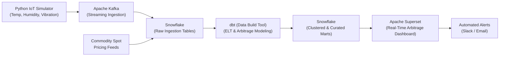

# AtmoSync: Micro-Climate Arbitrage Analytics

---

## 📌 Problem Statement

Traditional supply chain analytics rely heavily on static transit times and generic macro-weather forecasts. They fail to track how real-time, hyper-local micro-climate shifts (such as sudden humidity or temperature spikes inside individual shipping containers) degrade agricultural commodities before they reach the market.

---

## 🎯 Use Case

A commodities trader at **Infotact** monitors the **AtmoSync** real-time dashboard:

1. **Telemetry Drift Detection:** The streaming pipeline detects an unpredicted internal temperature drift in *Container A*, accelerating the spoilage rate of fresh avocados inside.
2. **Instant Arbitrage Computation:** The platform dynamically calculates **"Spoilage Arbitrage"**—balancing projected shelf-life degradation against market transit distances and real-time spot commodity prices.
3. **Actionable Rerouting Alert:** The trader receives an immediate alert recommending rerouting the shipment to a closer, secondary market.
4. **Value Preserved:** Goods are sold at a premium quality grade before falling below acceptable market thresholds, securing revenue and mitigating catastrophic spoilage losses.

---

## 🏗️ System Architecture & Key Modules

### 1. Streaming Ingestion (Apache Kafka)
* High-throughput event streaming architecture ingesting continuous telemetry from simulated IoT container sensors (temperature, humidity, vibration).

### 2. Cloud Data Warehouse (Snowflake)
* Highly scalable centralized cloud data warehouse storing raw high-velocity JSON IoT streams alongside historical and live commodity pricing feeds.

### 3. Data Transformation (dbt Core)
* Modular ELT modeling to unpack and clean raw JSON payloads, join telemetry with spot market pricing, and evaluate complex spoilage degradation curves and arbitrage margins directly in SQL.

### 4. Visualization Layer (Apache Superset)
* Real-time executive BI dashboards visualizing live container health, route progression, financial exposure, and high-margin reroute opportunities.

---

## 📅 Week-wise Development Plan

| Week | Data Engineering Track (Kafka, Snowflake, dbt) | Analytics & Visualization Track (Superset) |
| :--- | :--------------------------------------------- | :----------------------------------------- |
| **Week 1** | **Ingestion Architecture:** • Build Python IoT simulator generating container telemetry. • Set up Kafka topics and stream data into Snowflake raw tables. | **BI Foundations:** • Deploy Apache Superset. • Connect Superset to Snowflake warehouse and configure user access roles. |
| **Week 2** | **ELT Pipeline:** • Configure dbt Core. • Write SQL staging models to clean raw JSON IoT payloads and join with mock commodity pricing data. | **Initial Dashboards:** • Build baseline charts showing historical container routes and basic temperature fluctuations. |
| **Mid-Project Review** | **Pipeline Validation:** • Benchmark Kafka event streaming for zero-lag high-frequency ingestion. • Validate dbt staging models compile and run cleanly. | **Data Integrity Check:** • Ensure Superset correctly renders raw data tables directly from Snowflake. |
| **Week 3** | **Advanced Analytics:** • Write complex dbt models calculating the **Spoilage Arbitrage** metric (`time-to-spoilage` vs. `distance-to-market`). | **Arbitrage UI:** • Build core arbitrage dashboard highlighting **"At-Risk"** containers and recommended reroute destinations. |
| **Week 4** | **Automation:** • Orchestrate dbt run schedules. • Optimize Snowflake query performance using table clustering and materialized views. | **Refine & Polish:** • Finalize the BI interface styling and UX. • Set up automated Slack/Email alerts triggered by arbitrage opportunities. |
| **Final Project Review** | **A fully automated, streaming ELT pipeline** handling high-velocity IoT data seamlessly. | **A real-time executive dashboard** driving immediate financial decision-making. |

---

## 🏁 Deliverables Summary

- [ ] **Streaming Pipeline:** Python IoT Telemetry Simulator + Kafka Topics + Snowflake Ingestion
- [ ] **Data Transformation:** dbt Core Project with staging, intermediate, and marts layers (spoilage curves & arbitrage metrics)
- [ ] **Data Warehouse:** Optimized Snowflake data models (clustering, materialized views)
- [ ] **Business Intelligence:** Interactive Apache Superset dashboards with automated reroute alerting
